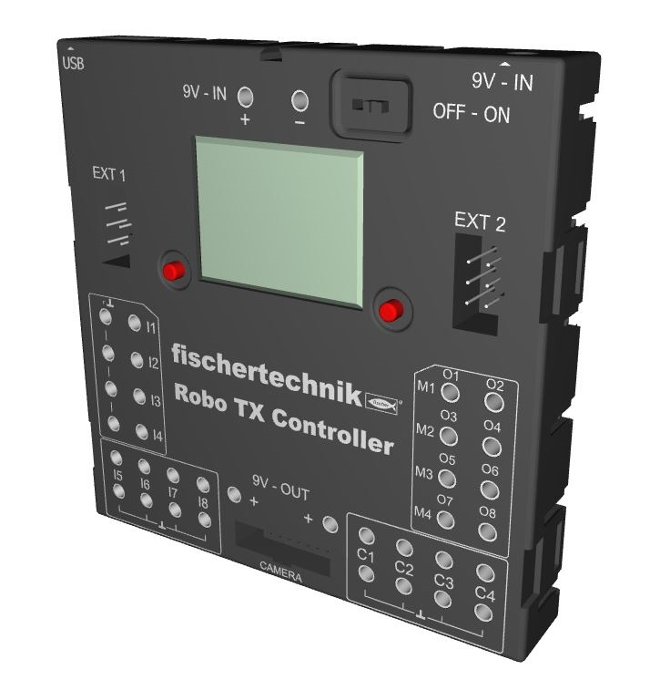
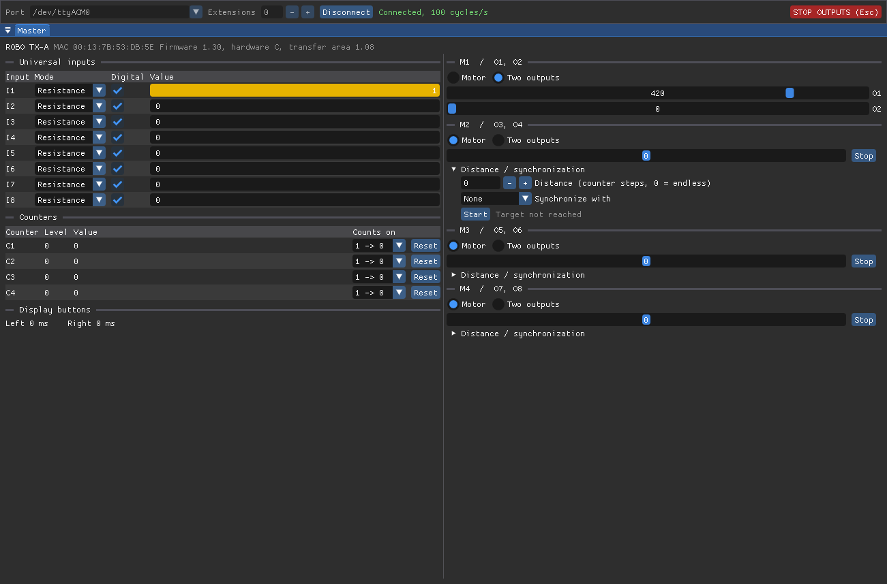

# ft-robotx

<p align="center">
  
</p>

Program the **fischertechnik ROBO TX Controller** in both of its modes, over **USB or Bluetooth**:

- **Online mode:** your program runs on the PC, and the TX acts as its I/O module. It reads the inputs and counters
  and drives the motors and outputs of the master and up to eight extension controllers. Libraries for C++ and
  C#, examples and a graphical test tool.
- **Offline mode** (*download mode*): your C program is compiled on the PC, uploaded to the TX and runs on the
  controller itself, without a PC. SDK, examples and a tool to upload, start and stop programs.

This is for the ROBO TX Controller only. The ROBO TXT and other fischertechnik controllers use different
protocols.

| Folder | What | Language |
| ------ | ---- | -------- |
| [`online/cpp/`](online/cpp) | Online mode: library, example programs, protocol tests and a graphical test tool | C++20, CMake |
| [`online/cs/`](online/cs) | Online mode: library and example programs | C# / .NET 10 |
| [`offline/`](offline) | Offline mode: SDK, example programs and a tool to upload, start and stop programs | C, CMake, Python |

## Background and thanks

This project would not exist without **Christoph Niessen**. His analysis of the TX's RS-485 extension bus
documents the packet format that the TX also speaks over USB and Bluetooth: the frame, the fields, the
checksum, the telecodes and the info structure. Thank you!

- Christoph Niessen: [Die RS-485-Schnittstelle des ROBO TX Controllers](https://web.archive.org/web/20261019230724/http://chris.cnie.de/ft/txc-rs485.html)
  (archived copy, German)

The meaning of the individual fields (input modes, motor/output configuration, counter reset, distance and
synchronization commands, version info) comes from fischertechnik's *PC Programming ROBO TX Controller*
package (`ROBO_TX_FW.h` and its documentation). The offline mode builds on fischertechnik's *C compiler package*
(C_Compiler_RoboTXC V1.2, firmware 1.30); its two headers `ROBO_TX_FW.h` and `ROBO_TX_PRG.h` are included in
[`offline/sdk/include`](offline/sdk/include), as their license note allows. Neither package's compiler or Windows
tools are needed or included.

Two things are not documented on the wire level: showing text on a controller's display (telecode 8) and asking
the master which extensions are connected (telecode 7). Both were found by analyzing how fischertechnik's PC
library implements them (`SetRoboTxMessage`, `STATE_RD_REQUEST`), and confirmed on real controllers.

## Contents

- [Access to the controller (Linux)](#access-to-the-controller-linux)
- [Connecting via USB](#connecting-via-usb)
- [Connecting via Bluetooth](#connecting-via-bluetooth)
- [Online mode: programs on the PC](#online-mode-programs-on-the-pc)
  - [Building](#building)
  - [Programs and examples](#programs-and-examples)
  - [The test tool](#the-test-tool-ftrobotx_gui)
  - [Using the library](#using-the-library)
- [Offline mode: programs on the controller](#offline-mode-programs-on-the-controller)
  - [Graphics on the display](#graphics-on-the-display)
- [Troubleshooting](#troubleshooting)

## Access to the controller (Linux)

Serial devices (`/dev/ttyACM*`, `/dev/rfcomm*`) belong to the group **`uucp`** on Arch Linux, or **`dialout`**
on Debian/Ubuntu. Add yourself to it once:

```bash
sudo usermod -aG uucp $USER       # Debian/Ubuntu: dialout instead of uucp
```

Group changes only apply to new logins, so **log out and back in** afterwards. Until then, `newgrp uucp`
gives just the current terminal the new group.

Direct Bluetooth connections (`bt:…`, see below) don't need the group. The same applies to the offline tool
`ftrobotx-load`.

## Connecting via USB

Plug in the controller; it appears as `/dev/ttyACM0` on Linux, or as a `COMx` port on Windows. The C++ programs,
the test tool and `ftrobotx-load` label or find it as *ROBO TX Controller (USB)* (USB ID `221d:1000`).

To use **extensions**, connect them to the master with the EXT cable and set each one's role in its menu to
*Extension 1*, *Extension 2*, …. The programs address them as extension 1, 2, … in exactly that order.

## Connecting via Bluetooth

First pair the controller once (its Bluetooth must be switched on):

```bash
bluetoothctl
```

```text
scan on              # wait until "ROBO TX-…" appears, note its address
pair 00:13:7B:53:DB:5E
trust 00:13:7B:53:DB:5E
quit
```

`bluetoothctl connect` is not needed. It fails with `ProfileUnavailable` because the TX uses the serial port
profile (SPP), which BlueZ doesn't connect itself. That's expected.

There are two ways to connect after pairing.

### Option 1: direct connection (C++, the test tool and `ftrobotx-load`, Linux)

Pass `bt:` plus the controller's address as the port:

```bash
online/cpp/build/ftrobotx_gui -p bt:00:13:7B:53:DB:5E
```

This needs no root, no `rfcomm` binding and no group membership. The test tool lists paired ROBO TX controllers
in its port menu automatically.

### Option 2: rfcomm device (C#, other tools)

This binds the controller to a serial device `/dev/rfcomm0`, which every serial program can open. On Arch, the
`rfcomm` tool is in `bluez-deprecated-tools`:

```bash
sudo pacman -S bluez-deprecated-tools
```

The TX offers its serial port on RFCOMM channel 1 (`sdptool browse 00:13:7B:53:DB:5E` shows it):

```bash
sudo rfcomm bind 0 00:13:7B:53:DB:5E 1
```

`/dev/rfcomm0` then belongs to the `uucp` group like the USB port (see [Access](#access-to-the-controller-linux)).
The binding lasts until the next reboot; `sudo rfcomm release 0` removes it.

### Notes

- The Bluetooth link is only established with the first packet, which takes about **3.5 seconds**. The
  libraries allow up to 10 seconds for the first reply and 1 second for all later ones.
- Bluetooth manages about 25–30 request/reply cycles per second, USB about 100.
- Extensions behind the master on the EXT cable are reached through the master as usual.
- On **Windows**, pairing creates a `COMx` port; use that one.

## Online mode: programs on the PC

### Building

#### C++

You need CMake 3.28 or newer and a C++20 compiler (GCC, Clang or MSVC); Ninja is optional. The test tool also
needs what SDL3 needs to open a window (on Linux, X11 and/or Wayland development files, which desktop systems
usually have). CMake downloads SDL3 and Dear ImGui itself, pinned by version and checksum, so the first
configure takes a moment.

```bash
cd online/cpp
cmake -S . -B build -G Ninja -DCMAKE_BUILD_TYPE=Release
cmake --build build
ctest --test-dir build
```

| CMake option | Default | Meaning |
| ------------ | ------- | ------- |
| `FT_BUILD_GUI` | on | Build the test tool (downloads SDL3 and Dear ImGui) |
| `FT_BUILD_EXAMPLES` | on | Build the example programs |
| `FT_BUILD_TESTS` | on | Build the protocol tests |
| `FT_WARNINGS_AS_ERRORS` | off | Treat compiler warnings as errors |

When the project is used as a subproject, the GUI, examples and tests are off by default.

#### C#

You need the .NET 10 SDK.

```bash
cd online/cs
dotnet build FtRoboTx.slnx
```

### Programs and examples

#### Choosing the controller: `-p`

All programs (C++ and C#) choose the controller the same way:

- **`-p, --port PORT`**: the port the ROBO TX Controller is connected to:
  - `/dev/ttyACM0`: USB (Linux)
  - `/dev/rfcomm0`: Bluetooth via `rfcomm bind` (Linux, see [Bluetooth](#connecting-via-bluetooth))
  - `bt:00:13:7B:53:DB:5E`: Bluetooth directly by address (C++ on Linux only; no `rfcomm`, root or group needed)
  - `COM3`: USB or Bluetooth on Windows
- **Without `-p`**, the programs use the first ROBO TX Controller found on USB (by its USB ID `221d:1000`) and print
  which port that is. If there is none, they ask for `-p`.
- **`-h, --help`** shows all options of a program.

Ctrl+C stops the programs, and they switch all outputs off before exiting.

| Program | C++ (`online/cpp/build/…`) | C# (`online/cs/…`) | What it does |
| ------- | ------------------- | ----------- | ------------ |
| Test tool | [`ftrobotx_gui`](online/cpp/gui) | – | Shows and controls everything; see below |
| Button and lamp | [`ftrobotx_button_lamp`](online/cpp/examples/button_lamp.cpp) | [`examples/ButtonLamp`](online/cs/examples/ButtonLamp/Program.cs) | Lamp on O1 lights while the button on I1 is pressed |
| Extension test | [`ftrobotx_extension_test`](online/cpp/examples/extension_test.cpp) | [`examples/ExtensionTest`](online/cs/examples/ExtensionTest/Program.cs) | Master and extension 1 with button on I1 and lamp on O1 each, crosswise: each button switches the *other* controller's lamp |
| Display message | [`ftrobotx_message`](online/cpp/examples/message.cpp) | – | Shows a text on a controller's display, or clears it |
| Demo | [`ftrobotx_demo`](online/cpp/examples/main.cpp) | [`src/Program.cs`](online/cs/src/Program.cs) | The original demo: motor control with master and one extension |

Running them:

```bash
cd online/cpp && ./build/ftrobotx_button_lamp                 # controller on USB, found automatically
cd online/cpp && ./build/ftrobotx_button_lamp -p /dev/rfcomm0  # a given port
```

```bash
cd online/cs/examples/ButtonLamp && dotnet run -- -p /dev/ttyACM0   # options after "--" go to the program
```

`ftrobotx_button_lamp`, `ftrobotx_extension_test` and `ftrobotx_demo` (and the C# programs) only have `-p` and `-h`:

```text
Usage: ftrobotx_button_lamp [-p PORT]

Lamp on O1 lights while the button on I1 is pressed. Ctrl+C quits and switches the lamp off.

Options:
  -h, --help            Show this help and exit.
  -p, --port PORT       Port of the ROBO TX Controller: /dev/ttyACM0 (USB), /dev/rfcomm0 (Bluetooth via rfcomm),
                        bt:00:13:7B:53:DB:5E (Bluetooth directly, Linux) or COM3 (Windows).
                        Default: the first ROBO TX Controller found on USB.
```

`ftrobotx_message` also chooses the display and takes the text:

```text
Usage: ftrobotx_message [-p PORT] [-c N] [TEXT...]

Shows TEXT (up to 98 characters) on a controller's display. Without TEXT, the message on the
display is cleared.

Options:
  -h, --help            Show this help and exit.
  -p, --port PORT       Port of the ROBO TX Controller: /dev/ttyACM0 (USB), /dev/rfcomm0 (Bluetooth via rfcomm),
                        bt:00:13:7B:53:DB:5E (Bluetooth directly, Linux) or COM3 (Windows).
                        Default: the first ROBO TX Controller found on USB.
  -c, --controller N    Display to use: 0 = master (default), 1 ... 8 = extension 1 ... 8.
```

For example `ftrobotx_message Hello` (master), `ftrobotx_message -c 2 Hello` (extension 2), `ftrobotx_message -c 2`
(clears it).

### The test tool (`ftrobotx_gui`)

A test tool in the spirit of fischertechnik's *RoboTxTest*, for checking wiring, sensors and motors quickly.

<p align="center">
  
</p>

```bash
./build/ftrobotx_gui                                 # choose port and number of extensions, then Connect
./build/ftrobotx_gui -p /dev/ttyACM0 -e 1            # connect right away: master and 1 extension
./build/ftrobotx_gui -p bt:00:13:7B:53:DB:5E -e 1    # the same via Bluetooth
```

```text
Usage: ftrobotx_gui [-p PORT] [-e N]

Test tool: shows and controls the inputs, outputs, counters and display of a ROBO TX Controller
and its extensions. Without -p, choose the port in the window and press Connect.

Options:
  -h, --help            Show this help and exit.
  -p, --port PORT       Connect right away to this port: /dev/ttyACM0 (USB), /dev/rfcomm0 (Bluetooth via
                        rfcomm), bt:00:13:7B:53:DB:5E (Bluetooth directly, Linux) or COM3 (Windows).
  -e, --extensions N    Number of extensions behind the master, 0 ... 8 (default: 1).
```

- The **port menu** lists ROBO TX controllers on USB, paired ROBO TX controllers for Bluetooth, and bound rfcomm
  devices. You can also type any port.
- Each controller has its own window. They start as tabs; drag a tab to dock it beside or below another, or use
  **Layout** → *Side by side* / *Stacked* / *Tabs*. The arrangement is remembered (on Linux in
  `~/.local/share/ft-robotx/gui/imgui.ini`).
- Each window shows:
  - **Universal inputs I1–I8**: mode (voltage in mV, resistance in Ω, ultrasonic distance in cm), analog or
    digital, and the current value.
  - **Counters C1–C4**: level and value, the counting edge, and a reset button.
  - **Display**: how long each display button has been held (in ms), and a field to show a text (up to 98
    characters) on that controller's display, or to clear it.
  - **M1–M4**: each pair either as a motor (speed −512…512; distance, synchronization and *Start* for distance
    commands) or as two separate outputs O1–O8 (0…512).
- Configuration changes are sent to the controller immediately.
- **STOP OUTPUTS** (or Esc) stops every motor and output, including running distance commands. Disconnecting or
  closing the tool does the same. The connection stays open.

### Using the library

C++, with CMake:

```cmake
add_subdirectory(ft-robotx/online/cpp)
target_link_libraries(my_app PRIVATE ftrobotx::ftrobotx)
```

```cpp
#include <ftrobotx/FtConnection.hpp>

using namespace ftrobotx;

FtConnection tx("/dev/ttyACM0", 2); // master + extension 1; or "bt:00:13:7B:53:DB:5E"
while (running)
{
    tx.update(); // sends outputs (and changed configuration), reads inputs
    bool pressed = tx.digitalValue(ExtensionIndex::Local, UniversalInput::I1);
    tx.setMotorOutput(ExtensionIndex::Slave1, Motor::M1, pressed ? 512 : 0);
}
tx.showMessage(ExtensionIndex::Local, "Hello"); // text on the master's display; "" clears it
bool extension1 = tx.extensionsOnline()[0];     // is extension 1 connected to the master?
tx.stopAllOutputs();
tx.update();
```

C#:

```csharp
using FtRoboTx;
using FtRoboTx.Extensions;

using FtConnection tx = new("/dev/ttyACM0", numExtensions: 2);
tx.Update();
bool pressed = tx.GetDigitalValue(ExtensionIndex.Local, UniversalInput.I1);
tx.SetMotorOutput(ExtensionIndex.Slave1, Motor.M1, pressed ? (short)512 : (short)0);
tx.ShowMessage(ExtensionIndex.Local, "Hello"); // text on the master's display; "" clears it
bool extension1 = tx.GetExtensionsOnline()[0];  // is extension 1 connected to the master?
```

Every change takes effect with the next `update()` / `Update()`. Call it regularly: the TX refreshes its I/O
every 10 ms.

## Offline mode: programs on the controller

In offline mode, your C program runs on the TX itself. The firmware calls it every millisecond; it reads inputs and
sets outputs directly in the controller's memory (the *transfer area*), for the master and, through it, for the
extensions. The PC is only needed to build and upload the program.

### How it works

A program consists of two functions, just like in fischertechnik's C compiler package:

- `PrgInit()` is called once when the program starts. Configure inputs and outputs here.
- `PrgTic()` is called every millisecond. It should return within about 0.5 ms, so the firmware still has time for
  its own work. Its return value says what happens next: `0x7FFF` to keep running, `0` to stop, anything else to
  stop and show that number as an error code on the display.

The build creates a `.bin` file. `ftrobotx-load` uploads it to the controller's RAM disk (lost when switched off) or
flash disk (kept), loads it into program memory and starts it. It uses the controller's remote shell and Xmodem,
like fischertechnik's Windows tools `4load_ft.exe` and `4cmd_ft.exe`, over USB or Bluetooth.

### Toolchain

You need GCC for bare-metal ARM (`arm-none-eabi-gcc`), CMake 3.28 or newer, and Python 3.

```bash
sudo pacman -S arm-none-eabi-gcc arm-none-eabi-binutils    # Arch
```

```bash
sudo apt install gcc-arm-none-eabi binutils-arm-none-eabi  # Debian/Ubuntu
```

On **Windows**, install the *Arm GNU Toolchain* for `arm-none-eabi` from Arm, CMake, Ninja and Python, and run
`pip install pyserial` (needed for COM ports). The Windows path is written but not yet tested.

This is a current GCC, not the YAGARTO GCC 4.4.1 from fischertechnik's package. Three things make sure the result
fits the 2012 firmware:

- The build checks every structure of the transfer area against the sizes the firmware uses (1024 bytes per
  controller, function table at offset 524). If a compiler or a flag ever changed the layout, the build fails
  instead of the program misbehaving on the controller.
- A small entry stub aligns the stack the way current GCC expects before the program runs.
- Enums are 4 bytes, as for the firmware (`-fno-short-enums`).

One thing to know: don't pass `float`/`double` values to the firmware's `sprintf` (in the hook table). The 2012
firmware handles floating-point arguments differently; integers and strings are fine.

### Building

```bash
cd offline
cmake -S . -B build -G Ninja
cmake --build build
```

This creates `build/ButtonLamp.bin` and `build/ExtensionTest.bin`.

### Uploading, starting and stopping

`offline/tools/ftrobotx-load` has one command per action (`deploy`, `run`, `stop`, …). **The options `-p` and `-v`
come before the command**, the command's own options after it:

```bash
./tools/ftrobotx-load deploy build/ButtonLamp.bin                        # controller on USB, found automatically
./tools/ftrobotx-load -p bt:00:13:7B:53:DB:5E deploy build/ButtonLamp.bin  # via Bluetooth
./tools/ftrobotx-load -p /dev/ttyACM0 deploy --flash build/ButtonLamp.bin  # keep it on the flash disk
```

- **`-p, --port PORT`**: the controller's port, as in online mode: `/dev/ttyACM0` (USB), `/dev/rfcomm0` (Bluetooth
  via rfcomm), `bt:00:13:7B:53:DB:5E` (Bluetooth directly, Linux) or `COM3` (Windows). Without `-p`, it uses the
  first ROBO TX Controller found on USB and prints which port that is.
- **`-v, --verbose`**: also shows the shell commands sent to the controller.
- **`-h, --help`**: shows the help; `ftrobotx-load COMMAND --help` shows a command's own options.

No other program, such as `ftrobotx_gui`, may be connected to the controller at the same time.

```text
usage: ftrobotx-load [-h] [-p PORT] [-v]
                     {deploy,upload,load,run,stop,dir,del,shell} ...

Upload, load, start and stop programs on a fischertechnik ROBO TX Controller.

positional arguments:
  {deploy,upload,load,run,stop,dir,del,shell}
    deploy              stop the running program, upload, load and start a
                        program
    upload              upload a file to the RAM disk (or flash disk)
    load                load a program file into program memory
    run                 start the loaded program
    stop                stop the running program
    dir                 list a disk
    del                 delete a file
    shell               interactive remote shell

options:
  -h, --help            show this help message and exit
  -p, --port PORT       port of the ROBO TX Controller: /dev/ttyACM0 (USB),
                        /dev/rfcomm0 (Bluetooth via rfcomm),
                        bt:00:13:7B:53:DB:5E (Bluetooth directly, Linux) or
                        COM3 (Windows); default: the first ROBO TX Controller
                        found on USB
  -v, --verbose         also show the shell commands sent to the controller
```

| Command | What it does |
| ------- | ------------ |
| `deploy [--flash] [--name NAME] FILE` | Stop the running program, upload FILE, load and start it |
| `upload [--flash] [--name NAME] FILE` | Only upload FILE |
| `load PATH` | Load a program that's already on the controller, e.g. `/ramdisk/ButtonLamp.bin` |
| `run` / `stop` | Start / stop the loaded program |
| `dir [DISK]` | List a disk: `ramdisk`, `flash` or `system` (default: all) |
| `del PATH` | Delete a file, e.g. `/flash/ButtonLamp.bin` |
| `shell` | Type the controller's own shell commands (`help` lists them) |

Options of `deploy` and `upload`:

- **`--flash`**: store on the flash disk, which keeps it when the controller is switched off (default: RAM disk).
- **`--name NAME`**: file name on the controller (default: the name on the PC).

```text
usage: ftrobotx-load deploy [-h] [--flash] [--name NAME] file

positional arguments:
  file         program file (.bin)

options:
  -h, --help   show this help message and exit
  --flash      store on the flash disk (kept when switched off)
  --name NAME  file name on the controller (default: as on the PC)
```

On Windows, run it as `python tools\ftrobotx-load …`.

Each example also has a CMake target that builds and deploys in one go; the port comes from the CMake variable
`FTROBOTX_PORT` (empty: USB):

```bash
cmake --build build --target ButtonLamp-deploy
```

Programs on the RAM disk are gone after switching off. To start a program from the flash disk automatically, choose
it in the controller's file menu and enable *Load after power-on* and *Start after power-on* there. On the
controller itself, the left button starts and stops the loaded program.

### Examples

The same two examples as in online mode:

| Program | Source | What it does |
| ------- | ------ | ------------ |
| `ButtonLamp` | [`offline/examples/button_lamp.c`](offline/examples/button_lamp.c) | Lamp on O1 lights while the button on I1 is pressed |
| `ExtensionTest` | [`offline/examples/extension_test.c`](offline/examples/extension_test.c) | Master and extension 1, crosswise: each button switches the *other* controller's lamp; shows "Extension 1 not connected" on the display if the extension is missing |
| `DisplayDemo` | [`offline/examples/display_demo.c`](offline/examples/display_demo.c) | Uses the [graphics library](#graphics-on-the-display): a title, the seconds since the start as a large number, a progress bar, and a box that fills while the button on I1 is pressed |
| `IoMonitor` | [`offline/examples/io_monitor.c`](offline/examples/io_monitor.c) | A display-only relative of the test tool: inputs (digital, ohm, mV) and counters of the master and all connected extensions, one page each; the display buttons flip through the pages |

The extension needs no program of its own: the master's program controls it through its transfer area
(`TA_EXT_1`), like a PC does in online mode.

### Graphics on the display

[`robotx_gfx.h`](offline/sdk/include/robotx_gfx.h) is a small graphics library for the controller's display
(128 × 64 pixels, monochrome). It's part of the SDK; programs that don't use it don't get any bigger.

```c
#include "robotx_gfx.h"

void PrgInit(TA * p_ta_array, int ta_count)
{
    gfx_begin(&p_ta_array[TA_LOCAL]);              // take over the display
}

int PrgTic(TA * p_ta_array, int ta_count)
{
    // ... e.g. every 100 ms (see DisplayDemo):
    gfx_clear();
    gfx_text(0, 0, "Counter", 1, GFX_BLACK);       // text, scale 1 = 6 x 8 pixels per character
    gfx_number(0, 12, 42, 3, GFX_BLACK);           // number, three times as large
    gfx_rect(80, 10, 40, 30, GFX_BLACK);           // outline
    gfx_fill_rect(84, 14, 32, 22, GFX_BLACK);      // filled
    gfx_show(&p_ta_array[TA_LOCAL]);               // show what was drawn
    return 0x7FFF;
}
```

| Function | What it does |
| -------- | ------------ |
| `gfx_begin(p_ta)` / `gfx_end(p_ta)` | Take over the display / give it back to the firmware's menus |
| `gfx_show(p_ta)` | Show everything drawn since the last call |
| `gfx_clear()` | Clear the picture |
| `gfx_pixel`, `gfx_line`, `gfx_rect`, `gfx_fill_rect`, `gfx_circle`, `gfx_fill_circle` | Draw; coordinates outside the display are clipped |
| `gfx_text(x, y, text, scale, color)`, `gfx_number(…)`, `gfx_text_width(…)` | Text and numbers in a 5 × 7 pixel font (printable ASCII), at any whole-number scale |

Colors are `GFX_BLACK`, `GFX_WHITE` and `GFX_INVERT` (flips pixels, e.g. for highlighted text).

- You draw into a buffer of your own; `gfx_show()` hands the firmware a finished copy, so it never shows a
  half-drawn picture.
- Redraw a few times per second, not every millisecond: `PrgTic()` must stay within its 0.5 ms.
- While the program owns the display, the firmware's *Stop* label is hidden. Press **both** display buttons to stop
  the program, or use `ftrobotx-load stop`.
- The display format isn't documented. It was determined with test patterns on a controller (firmware 1.30): 16
  bytes per pixel row, top row first, highest bit = leftmost pixel, set bit = dark pixel.

### Writing your own program

Add a C file and register it in [`offline/CMakeLists.txt`](offline/CMakeLists.txt):

```cmake
ftrobotx_add_program(MyProgram my_program.c)
```

```c
#include "ROBO_TX_PRG.h"

void PrgInit(TA * p_ta_array, int ta_count)
{
    (void)ta_count;                                 // number of transfer areas, always TA_COUNT
    TA * p_ta = &p_ta_array[TA_LOCAL];              // TA_EXT_1 ... TA_EXT_8 for extensions
    p_ta->config.uni[0].mode = MODE_R;              // I1: button (resistance, digital)
    p_ta->config.uni[0].digital = TRUE;
    p_ta->config.motor[0] = FALSE;                  // O1/O2 as separate outputs, not motor M1
    p_ta->state.config_id += 1;                     // tell the firmware the configuration changed
}

int PrgTic(TA * p_ta_array, int ta_count)
{
    (void)ta_count;
    TA * p_ta = &p_ta_array[TA_LOCAL];
    p_ta->output.duty[0] = p_ta->input.uni[0] ? DUTY_MAX : 0;
    return 0x7FFF;                                  // keep running
}
```

- The transfer area fields are described in [`ROBO_TX_FW.h`](offline/sdk/include/ROBO_TX_FW.h) and in
  fischertechnik's documentation. Before a program starts, the firmware sets all configuration and outputs to 0.
- There is no C library. The usual functions (`sprintf`, `strcpy`, `memset`, …), the system time
  (`GetSystemTime`), display messages (`DisplayMsg`), Bluetooth messaging and I2C are in
  `p_ta->hook_table`. For drawing on the display, use the [graphics library](#graphics-on-the-display).
- Never wait in a loop inside `PrgTic()`. Remember the time with `GetSystemTime()` and check it in later calls.
- Set the start values of global and static variables in `PrgInit()`. Variables without an initializer are zero
  at every start, but initialized ones (`static int x = 5;`) keep their last value when the program is stopped
  and started again without being reloaded.

## Troubleshooting

| Problem | Cause and fix |
| ------- | ------------- |
| `Permission denied` when opening the port | You're not in the `uucp`/`dialout` group yet, or haven't logged in again since joining it. See [Access](#access-to-the-controller-linux). |
| `No response from controller (got 0 of … bytes)` | Wrong port, the controller is off, or (Bluetooth) the link didn't come up. Check the port; for Bluetooth, check pairing and that the controller's Bluetooth is on. |
| `Config failed!`, or an extension shows no name or MAC | The extension isn't reachable: check the EXT cable and that its role is set to the right *Extension n*. The test tool shows a warning in that extension's window (it asks the master which extensions are connected). |
| `bluetoothctl connect` fails with `ProfileUnavailable` | Expected; see [Bluetooth](#connecting-via-bluetooth). |
| Display shows *Programm Magic Fehler* | A file that isn't a program (no program header) was uploaded or loaded. Upload a `.bin` built by the offline project. |
| `ftrobotx-load` says the controller doesn't answer | Another program (e.g. `ftrobotx_gui`) is connected to the same port; close it. |
| Anything else | Set `FT_TRACE=1` to log every packet sent and received to stderr (C++ and C#). A timeout error also shows how much of the reply arrived. |

## Status

- Online and offline mode are tested on Linux with a master and one extension, via USB and Bluetooth.
- The Windows code (C++ serial port, `ftrobotx-load` with COM ports) is written but not yet tested on Windows.
- Not implemented: messages on the controller's display, the remote shell, and firmware updates.
